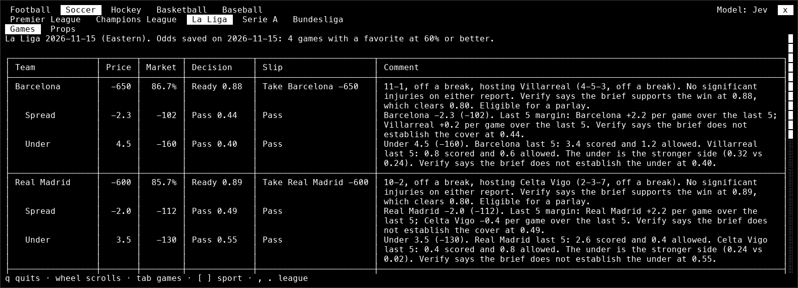
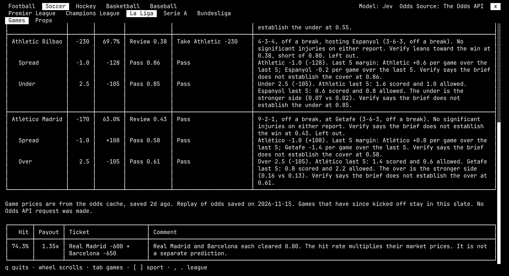
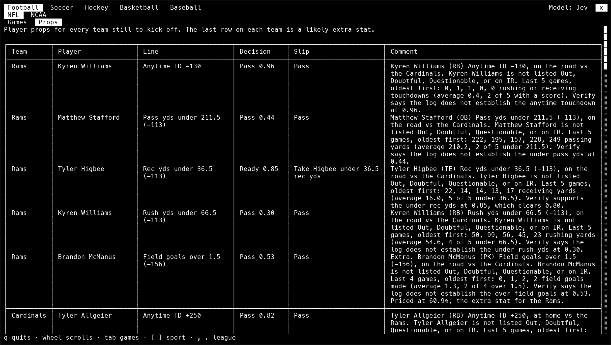

# Parlays

Finds 2- and 3-leg moneyline parlays for the NFL, NCAA football, six soccer leagues, the NHL, the NBA, MLB, and Formula 1. Each league has a Games board and a Props board.

The script pulls the slate from FanDuel, DraftKings, BetMGM, and Caesars, keeps favorites the market already prices at 60% or better, and builds a short brief for each one from ESPN's public injury report and team schedule. A decision model then keeps a pick only when that brief supports it. The default is [jev-recipes](https://github.com/agencyenterprise/jev-recipes) on TypeSafe. `model=tail-jev` uses Autojev on the tailnet instead. It prints the ten parlays with the highest combined implied hit rate.

No extra account is required for the briefs. ESPN's public site API is unauthenticated. `model=jev` uses the TypeSafe key. `model=tail-jev` uses the Autojev address and key in `.env`.

The pictures below are the saved Eastern day 2026-11-15. `npm run view -- 2026-11-15-jev` opens the jev slate, and `npm run compare -- 2026-11-15` opens both models. Neither command calls the Odds API. That snapshot was saved before Ligue 1 was on the slate, so the soccer row in these pictures has five leagues. A current run adds Ligue 1 after Bundesliga.

## How it works

`npm start` loads US moneylines, spreads, and totals for the slate. A moneyline stays on the board when its implied win probability is at least 0.60, about -150. Closer prices, such as -148, stay off. The script writes a brief for each favorite, then asks the decision model two questions.

1. `rerank` keeps up to 8 legs with relevance at least 0.60. The NFL asks which NFL team is very likely to win. NCAA asks the same about a college team. Soccer asks which team is very likely to win the match. The NHL, NBA, and MLB ask which team in that league is very likely to win the game. Formula 1 asks which driver is very likely to win the race, finish top 2, or finish on the podium. A favorite under that cutoff is `Dropped`.
2. `verify` reads the brief. The leg is ready for a ticket when the verdict supports the win and the confidence is at least 0.80. On Autojev that confidence is the probability of the chosen verdict. A choice response can also carry a separate confidence field. The gate uses the chosen option's probability.

Spreads and totals are checked the same way and stay on the Games page. Tickets are moneylines only, one leg per game.

### Games


The top row is the sport: Football, Soccer, Hockey, Basketball, Baseball, Formula 1. The model sits just left of the odds source, and the odds source sits just left of the x button. That label names the book or books that filled the slate. An old save from The Odds API still says `Odds Source: The Odds API`. Football then shows NFL and NCAA, and each of those shows Games and Props. Soccer shows the league, then Games and Props. Hockey shows NHL, Basketball shows NBA, Baseball shows MLB, and Formula 1 shows F1. A parent with one league still shows that league. When the sport names do not fit, they shorten to FB, Soc, Hockey, Bask, Base, and F1. Click a tab, or press Tab, Left, Right, or 1 and 2 for Games and Props. `[` and `]` change sport. `,` and `.` change league when that sport has more than one. The wheel moves the bar on the right. `q` and the x close the screen. The background is black.

Each favorite is three rows inside one border.

- The moneyline names the team. Price is the American odds and Market is the implied win probability. Decision is `Ready 0.82` when verify clears 0.80, `Review 0.70` when the brief was checked and the confidence is under 0.80, or `Dropped` when rerank scored the brief under 0.60. Slip is `Take Rams -510` when verify supports the win, and `Pass` when it does not. A supported win under 0.80 still shows Take, and the comment says that leg was left out of the tickets.
- The next row is the spread. Price is the point and Market is the juice. Slip is `Take Rams -9.5` when the brief supports the number, and `Take Cardinals +9.5` when the brief cuts against it. A missing spread shows `n/a`, `No line`, and `Pass`.
- The third row is Over or Under, whichever side the evidence supports more. The number is points in football and the NBA, goals in soccer and the NHL, and runs in MLB.

On this NFL board the Bills are -15000, a 99.3% favorite, and the slip is still Pass. Verify did not establish the win at 0.37, so the row says `Left out`. The Vikings and the Jaguars show Take because the brief leans toward the win, and Review because 0.26 and 0.77 are short of 0.80. Their spreads and totals are Pass. This page has no ticket. A ticket needs two moneylines the brief supports at 0.80 or better.

Prices come from FanDuel, then DraftKings, then BetMGM, then Caesars, then the first book that posted the market. The comment on that row names the book, so a moneyline and a spread on the same game can come from different books. A prop comment names its book the same way. NCAA, soccer, and MLB slips use the ESPN short name, so a slip can read `Take Man City -180` or `Take Red Sox -150`.

### A ticket



La Liga on the same day has four favorites at 60% or better. Barcelona is Ready 0.88 and Real Madrid is Ready 0.89. Both comments say the brief supports the win and the leg is eligible for a parlay. The spreads and totals on those games are Pass, so they stay off the ticket.



Scroll to the bottom of that page and a second table lists the tickets. Hit is the product of the moneyline implied probabilities. Payout is the decimal-odds product. This slate has one ticket, `Real Madrid -600 + Barcelona -650`, at 74.3% and 1.35x. The comment names the teams that cleared 0.80. Legs never share a game. The table keeps 2-leg and 3-leg parlays, the top 10 by hit rate.

The note under the games says these prices came from the odds cache for 2026-11-15, and that the replay kept games that have since kicked off. Fewer than two cleared legs prints `No parlay. A ticket needs two legs the brief supports at 0.80 or better.` No favorite at 60% prints `No qualifying legs.`

### Props



Props is the other page under the league. The columns are Team, Player, Line, Decision, Slip, and Comment. Each team still to play is one group. Decision is `Ready 0.82`, `Review 0.70`, or `Pass 0.61`. A missing market is `No line` and `Pass`. A check that did not come back is `No call`. Slip is filled in when that player's ESPN game log supports the side. Those rows stay off the tickets.

Football, for the NFL and NCAA, shows an anytime touchdown, passing yards, receiving yards, rushing yards, and one extra short-priced stat. The extra comes from receptions, passing touchdowns, completions, rush attempts, kicking points, and field goals. It stays on a player already in that group, or the kicker, and it skips a tiny under such as a backup under 1.5 receptions. On this Rams block, Kyren Williams's anytime touchdown is Pass at 0.96. Tyler Higbee's receiving yards are Ready 0.85, so the slip reads `Take Higbee under 36.5 rec yds`. That line is a prop. It is left out of the parlay.

Soccer shows an anytime goal, shots, shots on target, assists, and a card. A line posted on only one side is shown. The Champions League page says US books do not post player props for that competition, and it does not request them.

The NHL shows an anytime goal, points, shots on goal, assists, and one extra of goalie saves or power-play points. The NBA shows points, rebounds, assists, threes, and one extra of blocks or steals. MLB shows hits, home runs, RBIs, pitcher strikeouts, and one extra of total bases or stolen bases. Player props come from the same books as the game lines. The player log is ESPN's public athlete gamelog.

### Two models


`npm run compare -- 2026-11-15` opens the jev and tail-jev snapshots for that day on one screen. Both models saw the same saved prices. The header reads `Model: Jev · Tail-Jev`, then the odds source those prices came from. Decision columns sit side by side, then Agree and Slips.

Agree is Agreed when both slip strings match, including when both say Pass. It is Disagreed when the slips differ or one side has no row. On this page, 20 rows agree and 10 disagree. The Bills moneyline is one disagreement: jev is Review 0.37 and Pass, and tail-jev is Review 0.65 and `Take Bills -15000`. The Jaguars moneyline agrees, so the slip is shown once, `Take Jaguars -2500`. The same Agree column is on Props and on the ticket table. A ticket row agrees when both models include that ticket.

`model=jev` asks TypeSafe, through jev-recipes. That is also what runs when `model=` is left off. `model=tail-jev` asks Autojev on the tailnet, one question per call. `model=autojev` is the same choice. Both keep the 0.60 rerank gate and the 0.80 verify gate. Relevance is the yes probability.

## Requirements

- Node.js 22.23.4 or newer (`jev-recipes` requires it).
- A [TypeSafe API key](https://console.typesafe.ai/settings/keys) (`TYPESAFE_API_KEY`) for `model=jev`, the default. Those `rerank` and `verify` calls send the pick text and evidence to TypeSafe and use quota. `model=tail-jev` does not call TypeSafe. It needs `AUTOJEV_URL` and `AUTOJEV_API_KEY` in `.env`.
- No odds key. Prices come from FanDuel, DraftKings, BetMGM, and Caesars. Later runs reuse `odds-cache/` for the number of hours in `ODDS_CACHE_HOURS`. `npm start -- --fresh` reads those books again.

## Setup

```bash
cd parlay-slate
npm install
cp .env.example .env
cp .env.settings.example .env.settings
```

Put the TypeSafe key in `.env`. For `model=tail-jev`, also put the Autojev `/v1` base in `AUTOJEV_URL` and its bearer token in `AUTOJEV_API_KEY`. Leave `ODDS_SOURCE` blank to price the run from FanDuel, DraftKings, BetMGM, and Caesars. Set it to one of those names to read that book only. That file is gitignored. Cache settings go in `.env.settings`, which is also gitignored. `ODDS_CACHE_HOURS` is how long a saved response lasts. `ODDS_CACHE=0` ignores the cache. `ODDS_CACHE_DIR` changes the folder. A name in `.env` overrides the same name in `.env.settings`. A shell prefix overrides both.

## Run

```bash
# Current slate: this week's NFL and NCAA, plus each other league's scoreboard window. The model is jev.
npm start
# One America/New_York day for every league. The model is jev.
npm start -- 2026-11-15
# That Eastern day, ranked with TypeSafe through jev-recipes.
npm start -- 2026-11-15 model=jev
# That Eastern day, ranked with Autojev on the tailnet.
npm start -- 2026-11-15 model=tail-jev
# Replay prices saved that Eastern day through TypeSafe. Does not call the Odds API.
npm start -- odds=2026-11-15 model=jev
# Replay prices saved that Eastern day through Autojev. Does not call the Odds API.
npm start -- odds=2026-11-15 model=tail-jev
# Ignore odds-cache and read the books again.
npm start -- --fresh
# Current slate from FanDuel only. The model is jev.
ODDS_SOURCE=fanduel npm start
# One Eastern day from FanDuel, ranked with TypeSafe.
ODDS_SOURCE=fanduel npm start -- 2026-11-15 model=jev
# That Eastern day from FanDuel, ranked with Autojev.
ODDS_SOURCE=fanduel npm start -- 2026-11-15 model=tail-jev
# Replay FanDuel prices saved that Eastern day through TypeSafe. Does not fetch.
ODDS_SOURCE=fanduel npm start -- odds=2026-11-15 model=jev
# Replay FanDuel prices saved that Eastern day through Autojev. Does not fetch.
ODDS_SOURCE=fanduel npm start -- odds=2026-11-15 model=tail-jev
# Read FanDuel again and ignore odds-cache.
ODDS_SOURCE=fanduel npm start -- --fresh
# List the Eastern days stored in odds-cache. Does not call the network.
npm run odds
# Open the jev and tail-jev snapshots for that day side by side. Does not call any API.
npm run compare -- 2026-11-15
# Delete every file in snapshots/. Leaves runs/ and odds-cache/.
npm run clear-snapshots
# Reopen runs/last-run.json. Does not call the Odds API, ESPN, or a decision model.
npm run view
# Open snapshots/2026-11-15-jev.json. Prices and decisions stay as they were on that run.
npm run view -- 2026-11-15-jev
```

`odds=2026-11-15` replays prices saved that America/New_York day. `npm run odds` lists the days in `odds-cache/` and does not call the network. A FanDuel day is labeled FanDuel. When that day's source is not the one in `.env`, the printed replay command starts with `ODDS_SOURCE=`. The replay still works after `ODDS_CACHE_HOURS`, keeps games that have since kicked off, and does not fetch. If that day has no save for the source you asked for, the run stops and names the other source when the day was saved there. Do not combine `odds=` with a slate date or with `--fresh`. ESPN evidence and the decision model still run, so a replay can test `jev` against `tail-jev` on the same saved prices.

Leave `ODDS_SOURCE` unset, or set `books`, to read FanDuel, DraftKings, BetMGM, and Caesars. The row still uses the first of those four that posted the market. Set `fanduel`, `draftkings`, `betmgm`, or `caesars` to read that one book. The same `model=` and `odds=` arguments apply, and `model=tail-jev` is the Autojev run on those prices. Each book prices moneylines, spreads, and totals for the NFL, NCAA, the NHL, the NBA, and the six soccer leagues, plus the full-game player props it posts as a two-way line. A market it does not post stays no line. A BetMGM soccer game with no plain 3-way moneyline stays no line at that book. Formula 1 driver prices come from FanDuel on every run. MLB stays no line while that season is off. One book's save does not replace another's. To replay a day saved by The Odds API before that live call was removed, prefix the command with `ODDS_SOURCE=the-odds-api`. That replay does not call The Odds API.

`npm start` looks up the slate, writes `runs/last-run.json` and a snapshot, then opens the screen. Odds responses are saved in gitignored `odds-cache/` and reused for `ODDS_CACHE_HOURS` (168 by default, which is 7 days). A later run does not refetch a sport while that save is inside the lifetime, even if the kickoff window moved. A cached board says when those prices were saved. Game lines and player props both go through that cache. `npm start -- --fresh` ignores that cache. `--fresh` reads the books again. `npm run view` opens the saved screen again and does not call the Odds API, FanDuel, ESPN, or a decision model.

With no arguments, the NFL and NCAA use the current ESPN week and skip games that have already kicked off. Each soccer league uses the games on its ESPN scoreboard and the following four days, so the rest of that matchweek is included. The NHL, NBA, MLB, and Formula 1 use the games on that competition's ESPN scoreboard, from one hour before the first to six hours after the last. A scoreboard with nothing still ahead uses one Eastern day. A `YYYY-MM-DD` argument is one America/New_York calendar day for every league, so Sunday night is included and Monday night is not.

Soccer moneylines include the draw. The draw is not a leg. A team still has to be priced at 60% or better. Spreads and totals are goals. The brief adds the FotMob league table, the home or away place, expected goals per game, and players FotMob still lists as unavailable at kickoff. A FotMob miss leaves the ESPN brief. The props are an anytime goal, shots, shots on target, assists, and a card, read from the ESPN game log.

NHL, NBA, and MLB moneylines are two-way. The NHL moneyline includes overtime. A team still has to be priced at 60% or better. NHL spreads and totals are goals. NBA spreads and totals are points. MLB spreads and totals are runs. MLB slips use the ESPN short name, so the Red Sox and the White Sox stay distinct.

Formula 1 prices always come from FanDuel. Each driver priced at 60% or better is one moneyline. The bet is the race win when that price clears 0.60, otherwise a top-2 finish, otherwise a podium. A driver keeps only that one bet. The Games page is the moneyline. The brief is the ESPN championship standing and the points from the last five races. A slip reads `Take Verstappen to finish top 2 -195`. Two or three drivers from the same race can share a ticket. The Props tab is a note. Qualifying, fastest lap, top 10, and team markets stay off the slate.

A window too narrow for the headers stacks each row: the name, then the other fields, then the comment. The status line reads `q quits · wheel scrolls · tab games · [ ] sport · , . league`, and it drops a hint when that row has only one choice. Before the screen, the terminal prints each league name, the board title, `Checking N of M claims...` while verify runs, `Odds cache hit` when prices were reused, and `Saved` plus the path of `runs/last-run.json`. A shell that is not a terminal prints every sport, league, and page as text, then exits. A league that throws shows the error on that league's Games and Props pages, and the other leagues still print.

## Where a sport lives

`sports/index.ts` is the parent-tab list, in screen order. Football is `sports/football/`, with NFL and NCAA under it. Soccer is `sports/soccer/`. Hockey, Basketball, Baseball, and Formula 1 are `sports/hockey/`, `sports/basketball/`, `sports/baseball/`, and `sports/formula1/`, with NHL, NBA, MLB, and F1 under them. Shared code sits in `slate/`, `props/`, `espn/`, `odds/`, and `ui/`. A new sport is a folder there plus one line in the list. The cache in `odds/cache.ts` covers every sport and every book, including game lines and player props. One book's file does not replace another's. An old Odds API file keeps the hash name it already had.

## Saved slate

`npm start` overwrites `parlay-slate/runs/last-run.json` after the lookups finish, then prints `Saved` and the file path. A second `npm start` exits while the first is still running, including while its screen is open. The message names the other process id. It also writes `snapshots/<day>-<model>.json`. The day is the `odds=` day, the slate date, or today's Eastern date. The next run of that same day and model copies the previous file into `snapshots/archive/` and then replaces that snapshot, so compare still opens the current name. Both folders are gitignored. Team pages, schedules, rosters, and gamelogs from ESPN are reused for the rest of the Eastern day. Injury reports are reused for 3 hours. The scoreboard is read on every run.

`npm run compare -- 2026-11-15` opens `snapshots/2026-11-15-jev.json` beside `snapshots/2026-11-15-tail-jev.json`. A missing file prints the `npm start` command that writes it. `npm run clear-snapshots` deletes the files in `snapshots/`, including `snapshots/archive/`, and leaves that folder, `runs/`, and `odds-cache/` in place.

The file is the finished screen, not the raw API responses. Each table cell is already decided. It stores:

- `savedAt`, the UTC time of that run.
- `model`, `jev` or `tail-jev`, which decision model produced the cells. Older files omit it.
- `oddsSource`, `fanduel`, `draftkings`, `betmgm`, `caesars`, `books`, or `the-odds-api`, which prices filled the slate. Older files omit it.
- `oddsDay`, the Eastern day whose saved odds were replayed. A live run omits it.
- `title`, the week or Eastern day and how many favorites qualified.
- `groups`, the Games rows: each favorite, its spread, and its over/under.
- `note`, when there is no parlay or no qualifying favorite.
- `ticketGroups`, the moneyline tickets, only when at least two wins cleared 0.80.
- `props`, the Props tab: its title, one group of rows per team, and the note under that table.

`npm run view` reads `runs/last-run.json` and draws it with the same screen. `npm run view -- 2026-11-15-jev` opens that snapshot. Prices and decisions stay as they were on that run. If the file is missing, the command says so and exits. Run `npm start` when you want a new slate.

The same command without npm is:

```bash
node --env-file-if-exists=.env.settings --env-file-if-exists=.env --import tsx scripts/parlays.ts
node --env-file-if-exists=.env.settings --env-file-if-exists=.env --import tsx scripts/parlays.ts 2026-11-15
ODDS_SOURCE=fanduel node --env-file-if-exists=.env.settings --env-file-if-exists=.env --import tsx scripts/parlays.ts 2026-11-15
```

## Where the brief comes from

`getEvidence` in `espn/evidence.ts` reads ESPN once per run:

- Season record and last five regular-season or playoff results, from each team's schedule.
- Days of rest, including a bye when the gap is 12 days or more.
- The injury report. Active players are skipped. Quarterbacks sort first, then Out, Doubtful, injured reserve, and Questionable. The brief keeps six listings per team, and includes the short report note for Out, injured-reserve, and quarterback listings.

Both models judge only that text. They do not look up the game themselves. If ESPN does not answer for a team, that side of the brief says there are no recent games and no significant injuries listed. The league still gets a board.

## Typecheck

```bash
npm test
npm run typecheck
```

`npm test` runs `node:test` through `tsx`. Those tests do not call The Odds API, ESPN, TypeSafe, or Autojev. `npm run typecheck` checks the TypeScript in this directory and does not emit JavaScript. The run command executes the TypeScript files directly with `tsx`.
