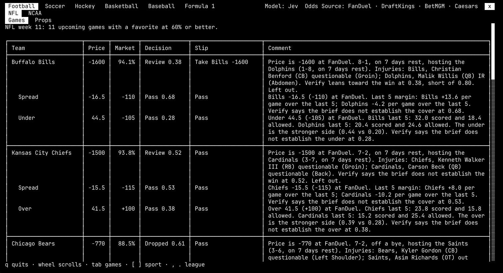

# Parlays

Finds 2- and 3-leg moneyline parlays for the NFL, NCAA football, seven soccer leagues, the NHL, the NBA, MLB, and Formula 1. Prices come from FanDuel, DraftKings, BetMGM, and Caesars. A decision model keeps a favorite only when the ESPN brief supports it.

The [user manual](docs/user-manual.md) covers setup, the launcher, the slate screen, tickets, props, and compare.



```bash
npm install
cp .env.example .env
cp .env.settings.example .env.settings
npm start
```

Put `TYPESAFE_API_KEY` in `.env` before a Jev run. `npm start` opens the launcher.
