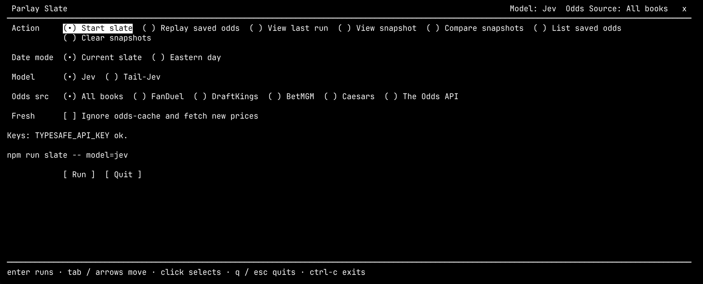
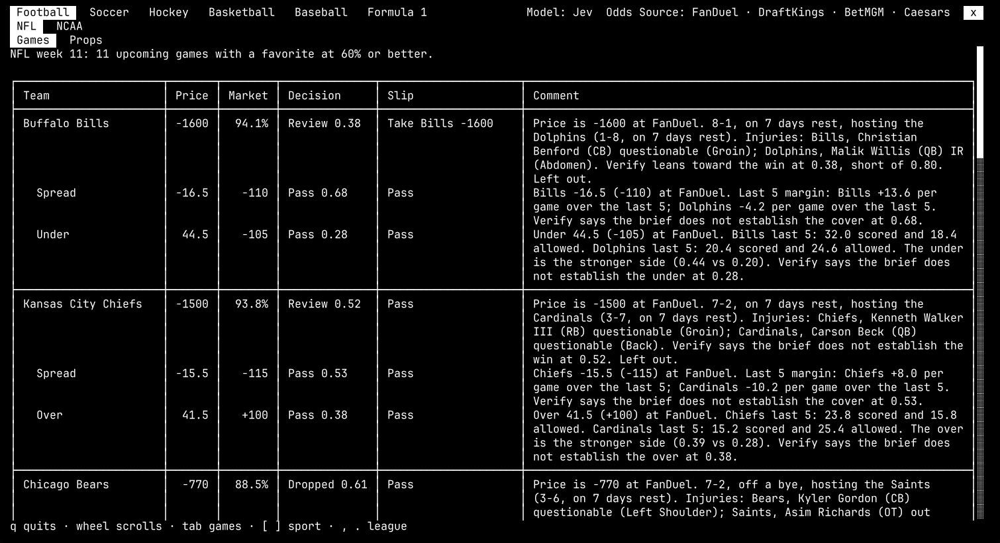
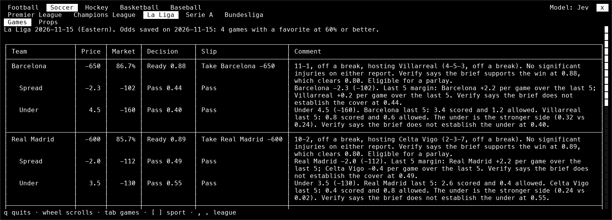
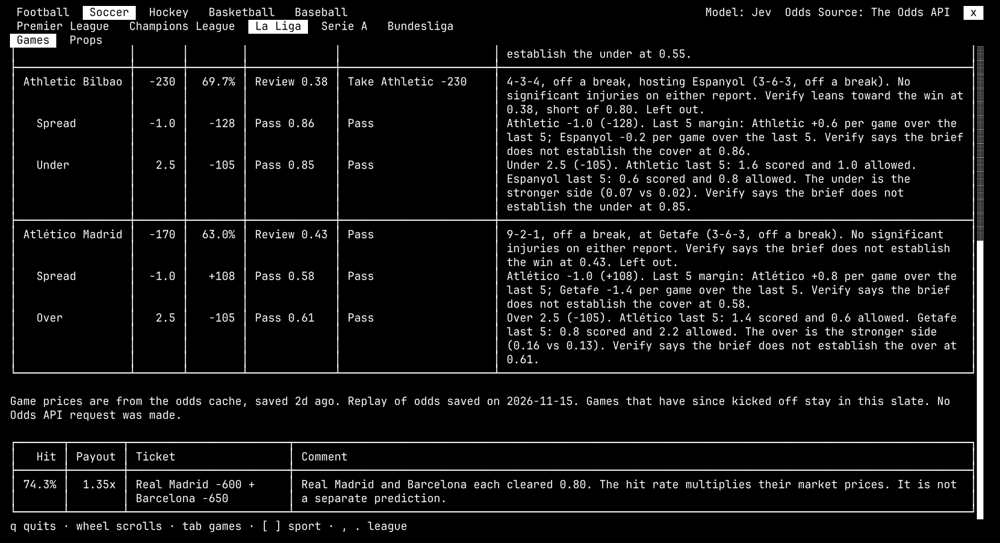
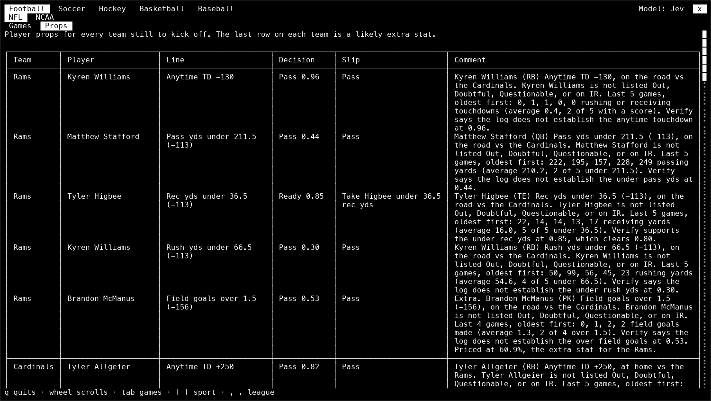
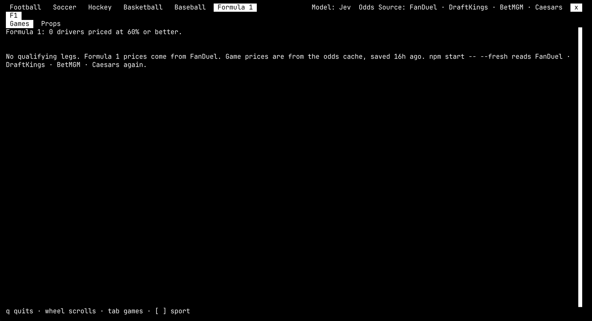
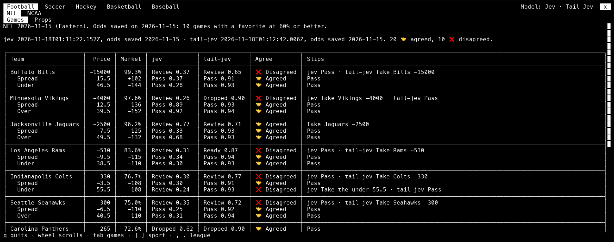

# Parlay Slate user manual

Parlay Slate finds 2-leg and 3-leg moneyline parlays for the NFL, NCAA football, seven soccer leagues, the NHL, the NBA, MLB, and Formula 1. Each league has a Games page and a Props page.

Prices come from FanDuel, DraftKings, BetMGM, and Caesars. The slate keeps a moneyline when the book already prices that side at 60% or better. It writes a short brief from ESPN, then asks a decision model whether the brief supports the pick. The default model is [jev-recipes](https://github.com/agencyenterprise/jev-recipes) on TypeSafe. `model=tail-jev` asks Autojev on the tailnet instead.

The pictures in this manual are saved slates, opened with `npm run view` and `npm run compare`. Those commands do not call a book, ESPN, or a decision model. A slate keeps the slip text it stored. Slips saved before the Lean wording still say `Take` for a supported pick under 0.80. A run today says `Lean` for that pick.

## Install

You need Node.js 22.23.4 or newer.

```bash
cd parlay-slate
npm install
cp .env.example .env
cp .env.settings.example .env.settings
```

Put `TYPESAFE_API_KEY` in `.env` before a Jev run. Those calls send the pick and the brief to TypeSafe and use quota. For Tail-Jev, also put the Autojev `/v1` address in `AUTOJEV_URL` and its bearer token in `AUTOJEV_API_KEY`. Tail-Jev does not call TypeSafe.

Leave `ODDS_SOURCE` blank to read FanDuel, DraftKings, BetMGM, and Caesars together. Set it to `fanduel`, `draftkings`, `betmgm`, or `caesars` to read one book. `.env` and `.env.settings` are gitignored. A name in `.env` wins over the same name in `.env.settings`. A shell prefix wins over both.

Cache settings live in `.env.settings`:

- `ODDS_CACHE_HOURS` is how long a saved price response lasts. The default is 168 hours, which is 7 days.
- `ODDS_CACHE=0` ignores the cache.
- `ODDS_CACHE_DIR` changes the folder. The default is `odds-cache/`.

There is no odds key. ESPN's public site is the evidence source and does not need an account.

## Open the launcher

In a terminal, `npm start` plays a short logo, then opens the options screen. Any key or a click skips the logo. `npm start -- --no-splash` skips it. `PARLAY_SLATE_NO_ANIM=1` holds a still logo. `npm run tui` opens the same screen. A pipe, or any run that is not a terminal, skips the launcher and prints the current slate as text.




Click a choice, or press Tab, Shift-Tab, and the arrow keys to move. Enter runs the focused action. The line under the form is the command that Run will use. `q`, Esc, Quit, or the x button leaves the launcher. Ctrl-C restores the terminal and exits.

The last options you run are kept in `runs/tui-settings.json`. The next launch opens on those choices.

### Actions

- **Start slate** prices the current slate, or one Eastern day, then opens the board. Current slate skips games that have already kicked off. Eastern day is one America/New_York calendar day for every league. Click the date to open a month grid. `[` and `]` step one day when the date field is focused. `,` and `.` change month inside the grid.
- **Replay saved odds** uses prices already stored for an Eastern day. It does not fetch. ESPN and the decision model still run, so you can compare Jev and Tail-Jev on the same prices. Do not combine a replay with Fresh.
- **View last run** opens `runs/last-run.json`. It does not call a book, ESPN, or a model.
- **View snapshot** opens one file in `snapshots/`. A path you passed on the command line, such as `npm run tui -- path.json`, is filled in here and is not written into the saved options.
- **Compare snapshots** opens the Jev and Tail-Jev boards for one day on one screen.
- **List saved odds** prints the Eastern days in `odds-cache/` and the replay command for each. `q` returns to the options.
- **Clear snapshots** asks before it deletes. The dialog opens on No. Type `yes`, or Tab to Yes, and then Enter. Enter on No closes the dialog and deletes nothing. `q` or Esc closes it. The delete removes every file in `snapshots/`, including `snapshots/archive/`, and leaves `runs/` and `odds-cache/`.

After a slate, a compare, or the saved-odds list closes, the options screen comes back. `q` on the board returns to the options. `q` on the options screen quits. A direct `npm run slate` or `npm run view` closes the screen and exits instead of returning to the options.

### Model and odds source

Jev is the TypeSafe model. Tail-Jev is Autojev. The header names the model and the odds source for Start and Replay. The other actions leave those spots as a dash.

All books reads FanDuel, DraftKings, BetMGM, and Caesars. The row still uses the first of those four that posted the market. One book reads only that book. The Odds API does not fetch. It only opens files saved before the live Odds API call was removed.

Fresh ignores `odds-cache/` and reads the books again. The box on the screen says "fetch new prices." That read is the sportsbooks, not The Odds API.

The form tells you when a key is missing. `Keys: TYPESAFE_API_KEY ok.` means the Jev key is set.

## Run from the command line

A date, `model=`, `odds=`, or `--fresh` skips the launcher. `model=` can sit before or after the date.

```bash
# Launcher.
npm start
npm start -- --no-splash
npm run tui

# Current slate. Games that have not kicked off. The model is Jev.
npm run slate

# One America/New_York day for every league.
npm run slate -- 2026-11-15
npm start -- 2026-11-15

# The same day, with Tail-Jev. model=autojev is the same choice.
npm start -- 2026-11-15 model=tail-jev

# Replay prices saved that Eastern day. Does not fetch.
npm run slate -- odds=2026-11-15 model=jev
npm start -- odds=2026-11-15 model=tail-jev

# Read the books again and ignore the cache.
npm run slate -- --fresh

# One book for this command.
ODDS_SOURCE=fanduel npm run slate -- 2026-11-15

# List saved odds days. Does not call the network.
npm run odds

# Open both models for that day. Does not call an API.
npm run compare -- 2026-11-15

# Delete snapshot files. Leaves runs/ and odds-cache/.
npm run clear-snapshots

# Reopen the last slate, or one snapshot.
npm run view
npm run view -- 2026-11-15-jev
```

`odds=` is the Eastern day the prices were saved, not the kickoff day. `npm run odds` lists those days. When the saved source is not the one in `.env`, the printed command starts with `ODDS_SOURCE=` so the value in `.env` does not hide that day. A replay still works after `ODDS_CACHE_HOURS`, and it keeps games that have since kicked off. If that day has no save for the source you asked for, the run stops and names the other source when the day was saved there. Do not combine `odds=` with a slate date or with `--fresh`.

Formula 1 prices come from FanDuel on every run, including when the odds source is another book or The Odds API.

A second slate exits while the first is still running, including while its screen is open. The message names the other process id. Sitting on the launcher does not hold that lock.

## The slate screen



The top row is the sport: Football, Soccer, Hockey, Basketball, Baseball, Formula 1. The model sits just left of the odds source. The odds source names the book or books that filled the slate. Just left of the x button, `Odds:` is the Eastern day those prices were saved. A replay shows the `odds=` day. An old save from The Odds API still says `Odds Source: The Odds API`. A save with no model or no odds source leaves that spot blank. The odds date drops when the sport names would not fit, and the model stays.

Football then shows NFL and NCAA. Soccer shows Premier League, Champions League, La Liga, Serie A, Bundesliga, Ligue 1, and MLS. Hockey shows NHL, Basketball shows NBA, Baseball shows MLB, and Formula 1 shows F1. A parent with one league still shows that league. Each league has Games and Props. Games stays first. The Games table adds a Date column after Team. Props adds Date after Team. That cell is the Eastern kickoff, with the weekday and the time. An older save without the cell keeps the columns it was stored with.

Click a tab, or use the keys:

- Tab, Shift-Tab, Left, Right, `1`, and `2` move between Games and Props.
- `[` and `]` change sport.
- `,` and `.` change league when that sport has more than one.
- The wheel scrolls three lines. A click or drag on the bar jumps.
- `g` goes to the top and `G` goes to the bottom.
- `q` and the x button close the screen. On a launcher run, `q` returns to the options. Ctrl-C restores the terminal.

When the sport names do not fit, they shorten to FB, Soc, Hockey, Bask, Base, and F1. A narrow terminal stacks each row: the name, then the other fields, then the comment. The status line reads `q quits · wheel scrolls · tab games · [ ] sport · , . league`, and it drops a hint when that row has only one choice.

Before the screen, the terminal prints each league, the board title, `Checking N of M claims...` while verify runs, `Odds cache hit` when prices were reused, and `Saved` plus the path of `runs/last-run.json`. A shell that is not a terminal prints every sport, league, and page as text, then exits. A league that throws shows the error on that league's Games and Props pages, and the other leagues still print.

## How a game row is decided

A moneyline stays on the board when its implied win probability is at least 0.60. That is about -150. The 0.60 gate reads the posted price, vig included, so a closer price such as -148 stays off.

The model then answers two questions.

1. Rerank keeps up to 8 favorites with relevance at least 0.60. The NFL asks which NFL team is very likely to win. NCAA asks the same about a college team. Soccer asks which team is very likely to win the match. The NHL, NBA, and MLB ask which team in that league is very likely to win the game. Formula 1 asks which driver is very likely to win the race, finish top 2, or finish on the podium. A favorite under that cutoff, or outside the top 8, is `Dropped`. The Decision cell includes the relevance.
2. Verify reads the brief. The leg is ready for a ticket when the verdict supports the pick and the confidence is at least 0.80. On Autojev that confidence is the probability of the chosen verdict, not a separate confidence field on the response.

A missing score or a missing verify result is `No call`. It is not a failed gate.

Each favorite is three rows inside one border.

- The moneyline names the team. Price is the American odds. Market is the implied win probability. Decision is `Ready 0.82` when verify clears 0.80, `Review 0.70` when the brief was checked and the confidence is under 0.80, or `Dropped` when rerank left it out.
- Slip is `Take Rams -510` when verify supports the win at 0.80 or better. It is `Lean Rams -510` when verify supports the win under 0.80. Anything else is `Pass`. A Lean leg stays off the tickets, and the comment says so.
- The next row is the spread. Price is the point and Market is the juice. A supported spread is `Take` at 0.80 or better and `Lean` under 0.80. A contradicted spread flips to the other side's opposite number, as `Take` when that side clears 0.80 and `Lean` when it does not. A missing spread shows `n/a`, `No line`, and `Pass`.
- The third row is Over or Under, whichever side the evidence supports more. The number is points in football and the NBA, goals in soccer and the NHL, and runs in MLB.

On the 2026-11-20 NFL board the Bills are -1600, a 94.1% favorite, and verify leans toward the win at 0.38. That is short of 0.80, so the row says `Left out`. The slip in the picture still says `Take Bills -1600` because that file was saved before Lean. A run today says `Lean Bills -1600`. The Chiefs are `Pass` because verify did not establish the win. The Bears are `Dropped 0.61` because they missed the top 8. This page has no ticket.

The comment names the book, so a moneyline and a spread on the same game can come from different books. NCAA, soccer, and MLB slips use the ESPN short name, so a slip can read `Take Man City -180` or `Take Red Sox -150`.

Soccer moneylines include the draw. The draw is not a leg. A team still has to be priced at 60% or better. Spreads and totals are goals. The brief adds the FotMob league table, the home or away place, expected goals per game, and players FotMob still lists as unavailable at kickoff. A FotMob miss leaves the ESPN brief.

NHL, NBA, and MLB moneylines are two-way. The NHL moneyline includes overtime. NHL spreads and totals are goals. NBA spreads and totals are points. MLB spreads and totals are runs.



La Liga on 2026-11-20 has five favorites at 60% or better. Real Madrid is Ready 0.88, so the slip is `Take Real Madrid -650` and the comment says the leg is eligible for a parlay. Barcelona is Review 0.70. The brief supports the win, but 0.70 is short of 0.80, so a run today says `Lean Barcelona -650` and leaves it off the ticket. The spread and the total on Real Madrid are Pass.

## Tickets

Scroll to the bottom of a Games page. When at least two moneylines cleared 0.80, a second table lists the tickets.



Hit is the product of the moneyline implied probabilities. Payout is the decimal-odds product. This slate has one ticket, `Real Madrid -600 + Barcelona -650`, at 74.3% and 1.35x. The comment names the teams that cleared 0.80. Legs never share a game. The table keeps 2-leg and 3-leg parlays, the top 10 by hit rate. Spreads, totals, and props are not legs.

Fewer than two cleared legs prints `No parlay. A ticket needs two legs the brief supports at 0.80 or better.` No favorite at 60% prints `No qualifying legs.`

The note under the 2026-11-15 board says the prices came from the odds cache and that the replay kept games that have since kicked off. That save has five soccer leagues. A current run adds Ligue 1 after Bundesliga, as the 2026-11-20 La Liga picture shows, and MLS after Ligue 1.

## Props

Props is the other page under the league. The columns are Team, Player, Line, Decision, Slip, and Comment. Each team still to play is one group. Decision is `Ready 0.82`, `Review 0.70`, or `Pass 0.61`. A missing market is `No line` and `Pass`. A check that did not come back is `No call`.

Slip is `Take` when the player's ESPN game log supports the side at 0.80 or better, and `Lean` when it supports the side under 0.80. Those rows stay off the tickets.



Football, for the NFL and NCAA, shows an anytime touchdown, passing yards, receiving yards, rushing yards, and one extra. The extra comes from receptions, passing touchdowns, completions, rush attempts, kicking points, and field goals. It stays on a player already in that group, or the kicker. It prefers a price of 0.60 or better and can be lower when none is. It skips a tiny under, such as a backup under 1.5 receptions. On this Rams block, Kyren Williams's anytime touchdown is Pass at 0.96. Tyler Higbee's receiving yards are Ready 0.85, so the slip reads `Take Higbee under 36.5 rec yds`.

Soccer shows an anytime goal, shots, shots on target, assists, and a card. A line posted on only one side is shown. The Champions League page says US books do not post player props for that competition, and it does not request them.

The NHL shows an anytime goal, points, shots on goal, assists, and one extra of goalie saves or power-play points. The NBA shows points, rebounds, assists, threes, and one extra of blocks or steals. MLB shows hits, home runs, RBIs, pitcher strikeouts, and one extra of total bases or stolen bases. The extra follows the same featured-player rule as football. Player props come from the same books as the game lines.

## Formula 1

Formula 1 is FanDuel only. Each driver priced at 60% or better is one moneyline. The bet is the race win when that price clears 0.60, otherwise a top-2 finish, otherwise a podium. A driver keeps only that one bet. Two drivers from the same race can share a ticket. The Games page has no spread and no total. A slip reads `Take Verstappen to finish top 2 -195`. The brief is the ESPN championship standing and the points from the last five races. The Props tab is a note. Qualifying, fastest lap, top 10, and team markets stay off the slate.



This saved day has no driver at 60% or better, so the page says `No qualifying legs` and names FanDuel. A race week with a short-priced driver shows that driver on Games the same way a team shows on the NFL page.

## Compare two models

`npm run compare -- 2026-11-15` opens the Jev and Tail-Jev snapshots for that day. Both models saw the same saved prices. The header reads `Model: Jev · Tail-Jev`, then the odds source. When the two saves came from different sources, both source names are shown.



Decision columns sit side by side, then Agree and Slips. Agree is Agreed when both slip strings match, including when both say Pass. It is Disagreed when the slips differ or one side has no row. On this page, 21 rows agree and 9 disagree. The Bills moneyline is one disagreement: Jev is Review 0.37 and Pass, and Tail-Jev is Review 0.65 and `Take Bills -15000`. The Jaguars moneyline agrees, so the slip is shown once. The same Agree column is on Props and on the ticket table. A ticket row agrees when both models include that ticket.

Both models keep the 0.60 rerank gate and the 0.80 verify gate. The `Take` slips in this picture are the text stored on that day. A run today says `Lean` when the support is under 0.80.

## Which games are included

With no date, the NFL and NCAA use the current ESPN week and skip games that have already kicked off. A finished game does not set that window. Each soccer league uses its ESPN scoreboard, from one hour before the first game still ahead to four days past the last of those, so the rest of that matchweek is included. A soccer scoreboard with nothing still ahead uses four Eastern days.

The NHL, NBA, MLB, and Formula 1 use the ESPN scoreboard, from one hour before the first game still ahead to six hours after the last. A finished game does not set that window. A scoreboard with nothing still ahead uses one Eastern day.

A `YYYY-MM-DD` argument is one America/New_York calendar day for every league. Sunday night is included and Monday night is not.

## Prices and the cache

The first time a slate reads a book, the response is saved in `odds-cache/`. A later run reuses that save while it is inside `ODDS_CACHE_HOURS`, for the games whose kickoff falls in the new window. The saved window has to cover the request. A cached board says when those prices were saved. Game lines and player props both go through that cache. `--fresh` reads the books again.

One book's file does not replace another's. An old Odds API file keeps the hash name it already had. To replay one of those days, prefix the command with `ODDS_SOURCE=the-odds-api`. That replay does not call The Odds API.

A book that does not post a market leaves `No line`. A BetMGM soccer game with no plain 3-way moneyline has no BetMGM moneyline. MLB stays empty while that season is off.

## Saved files

A slate run rewrites `runs/last-run.json` after each sport once a board exists, then writes `snapshots/<day>-<model>.json` when the run finishes. The day is the `odds=` day, the slate date, or today's Eastern date. The next run of that same day and model copies the previous file into `snapshots/archive/` and then replaces the snapshot, so compare still opens the current name. An identical rewrite does not add another archive file. A kill mid-run keeps the finished sports in `runs/last-run.json` and leaves the previous snapshot in place.

`runs/`, `snapshots/`, `odds-cache/`, and `espn-cache/` are gitignored. Team pages, schedules, rosters, and gamelogs from ESPN are reused for 18 hours on the same Eastern day. Injury reports are reused for 3 hours. The scoreboard is read on every run.

The snapshot is the finished screen, not the raw book response. Each table cell is already decided. It stores:

- `savedAt`, the UTC time of that run.
- `model`, `jev` or `tail-jev`. Older files omit it.
- `oddsSource`, `fanduel`, `draftkings`, `betmgm`, `caesars`, `books`, or `the-odds-api`. Older files omit it.
- `oddsDay`, the Eastern day whose saved odds were replayed. A live run omits it.
- `title`, the week or Eastern day and how many favorites qualified.
- `groups`, the Games rows.
- `note`, when there is no parlay or no qualifying favorite.
- `ticketGroups`, the moneyline tickets, only when at least two wins cleared 0.80.
- `props`, the Props tab.

`npm run view -- 2026-11-15-jev` opens `snapshots/2026-11-15-jev.json`. Prices and decisions stay as they were on that run. If the file is missing, the command says so and exits.

## Where the brief comes from

The brief is built once per team from ESPN:

- Season record and the last five regular-season or playoff results.
- Days of rest, including a bye when the gap is 12 days or more.
- The injury report. Active players are skipped. Quarterbacks sort first, then Out, Doubtful, injured reserve, and Questionable. The brief keeps six listings per team.

The model judges only that text. It does not look up the game itself. If ESPN does not answer for a team, that side of the brief says there are no recent games and no significant injuries listed. The league still gets a board. A failed decision call leaves that row as `No call` and keeps the board. The error is in the board note. Tail-Jev stops after three failures in a row.

## Checks

```bash
npm test
npm run typecheck
```

`npm test` does not call The Odds API, ESPN, TypeSafe, or Autojev. `npm run typecheck` checks the TypeScript and does not emit JavaScript.
